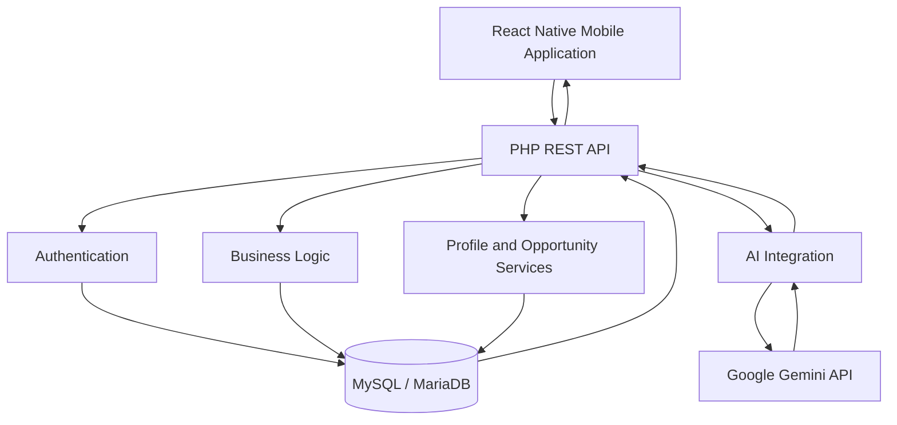

# CareerForge 🚀
### Empowering Graduate Employability Through AI and Digital Innovation

**CareerForge** is an AI-powered graduate employability platform designed to bridge the gap between academic qualifications and industry expectations. It helps students and graduates prepare for the professional world by providing career guidance, skills development opportunities, employment opportunities, and personalised career recommendations.

Developed as part of the Richfield Graduate Institute of Technology hackathon, CareerForge uses digital innovation and artificial intelligence to address graduate unemployment and improve career readiness.

---

## 📑 Table of Contents

1. [Overview](#-overview)
2. [The Problem](#-the-problem)
3. [Our Solution](#-our-solution)
4. [Key Features](#-key-features)
5. [User Roles](#-user-roles)
6. [Technology Stack](#-technology-stack)
7. [System Architecture](#-system-architecture)
8. [AI Integration](#-ai-integration)
9. [Database](#-database)
10. [Project Structure](#-project-structure)
11. [Getting Started](#-getting-started)
12. [API Overview](#-api-overview)
13. [Security](#-security)
14. [Future Improvements](#-future-improvements)
15. [Development Status](#-development-status)
16. [Acknowledgements](#-acknowledgements)
17. [License](#-license)

---

## 🌍 Overview

Graduate unemployment remains a significant challenge, particularly for students and recent graduates who struggle to transition from academic environments into the professional workplace.

Many graduates possess academic qualifications but lack the practical skills, industry exposure, professional experience, and career guidance required to compete effectively in the employment market.

CareerForge aims to address this challenge through a centralised digital platform that connects students, graduates, educational institutions, and businesses.

Rather than functioning solely as a job-search application, CareerForge focuses on improving an individual's overall employability through career assessments, skills development, AI-assisted guidance, and access to professional opportunities.

**Our vision is to transform how students prepare for employment by making career development more accessible, personalised, and data-driven.**

## ❗ The Problem

The transition from education to employment presents several challenges:

- **Skills Gap:** Graduates often lack specific technical and professional skills required by employers.
- **Limited Experience:** Students struggle to obtain relevant workplace experience before graduation.
- **Lack of Career Guidance:** Many students are uncertain about suitable career paths and the skills needed to pursue them.
- **Limited Industry Exposure:** Students often lack direct connections with businesses and potential employers.
- **Fragmented Opportunities:** Internships, graduate programmes, learnerships, and other opportunities are distributed across multiple platforms.
- **Poor Employability Awareness:** Students may not understand their strengths, weaknesses, or readiness for the employment market.

These challenges contribute to the gap between academic achievement and workplace readiness.

## 💡 Our Solution

CareerForge brings career development and employment opportunities together in one platform.

The platform provides a structured approach to employability by allowing students to:

1. Create and maintain professional profiles.
2. Identify and develop relevant skills.
3. Explore internships, graduate programmes, and learnerships.
4. Receive AI-assisted career guidance.
5. Assess their employability.
6. Identify areas requiring improvement.
7. Establish career goals and development roadmaps.
8. Connect with opportunities that support their professional development.

CareerForge also provides businesses with tools to publish opportunities and interact with prospective candidates, while administrators can oversee platform activities.

---

## ✨ Key Features

### 1. Student Dashboard
A centralised dashboard providing an overview of a student's career development journey.

- Personalised student information.
- Employability score.
- Career credits.
- Employment opportunity discovery.
- Access to career development features.

### 2. Profile Management
Students can create and maintain professional profiles containing relevant academic and career information.

- Personal information.
- Academic qualifications.
- Institution and study information.
- Professional skills.
- Profile management.

### 3. Skills Management
Students can manage their professional skill sets and identify areas for improvement.

- Add and manage skills.
- Track professional development.
- Identify relevant skills for career opportunities.
- Support skills-gap analysis.

### 4. Employment Opportunities
A centralised opportunity platform connecting students with businesses.

Supported opportunity categories include:

- Internships.
- Graduate programmes and graduate jobs.
- Learnerships.

Opportunity information can include:

- Position title and description.
- Required skills.
- Qualifications.
- Employment arrangement.
- Salary information, where provided.
- Application deadlines.
- Available positions.

### 5. Applications Management
Students can interact with available opportunities and manage their applications.

- Explore opportunities.
- View opportunity details.
- Submit applications.
- Access application information.

### 6. AI Career Assistant
An AI-powered career assistance feature designed to provide students with career-related guidance.

Using Google's Gemini API, the assistant supports career-related interactions and personalised recommendations.

The objective is to provide students with accessible guidance when making academic, professional, and career-development decisions.

### 7. Career Assessment and Employability Scoring
CareerForge incorporates employability assessment to help students understand their career readiness.

The employability score is calculated using a structured, weighted assessment rather than simply asking users to enter their own score.

AI-assisted analysis provides additional career guidance and recommendations.

### 8. Career Goals and Roadmaps
Students can work towards structured career objectives.

The platform aims to support:

- Career goal identification.
- Career development planning.
- Skills improvement.
- Personalised development recommendations.
- Progress towards employment readiness.

### 9. Business Portal
Businesses can access a dedicated interface to participate in the CareerForge ecosystem.

Business functionality includes:

- Business profile management.
- Publishing employment opportunities.
- Defining required skills and qualifications.
- Specifying opportunity arrangements.
- Managing opportunity information.

### 10. Alumni Portal
An alumni-focused environment designed to support graduates and encourage continued engagement with career opportunities and professional development.

### 11. Administration Dashboard
An administrative interface intended to support platform oversight.

Administrative functionality includes:

- Platform statistics.
- User management.
- Business oversight.
- Opportunity monitoring.
- Verification and approval workflows.

---

## 👥 User Roles

CareerForge supports four primary user categories.

| User Role | Description |
|---|---|
| Student | Creates a professional profile, develops skills, explores opportunities and receives career guidance. |
| Alumni | Accesses graduate-focused career opportunities and professional development functionality. |
| Business | Creates a business profile and publishes employment opportunities. |
| Administrator | Oversees platform activities and administrative operations. |

Each user category has a dedicated interface and role-specific functionality.

---

## 🛠 Technology Stack

CareerForge uses a client-server architecture, separating the mobile application, backend services, and database.

| Component | Technology | Purpose |
|---|---|---|
| Mobile Frontend | React Native | Cross-platform mobile application |
| Development Environment | Expo | Mobile application development and testing |
| Backend | PHP | Server-side logic and API development |
| Database | MySQL / MariaDB | Persistent data storage |
| AI Integration | Google Gemini API | AI-assisted career guidance and analysis |
| Authentication | PHP-based token authentication | Secure user authentication |
| API Communication | REST API / JSON | Frontend-backend communication |
| Database Management | phpMyAdmin | Database administration during development |
| Version Control | Git and GitHub | Source code management and collaboration |

### Frontend

The mobile application is developed using React Native and Expo.

This allows the application to provide a consistent mobile experience while supporting rapid development and testing through Expo Go.

### Backend

PHP handles server-side operations, including:

- User authentication.
- Profile management.
- Opportunity management.
- Application processing.
- Database interactions.
- AI service communication.
- API responses.

The backend exposes REST-style API endpoints that communicate with the React Native application using JSON.

### Database

MySQL/MariaDB provides persistent storage for user information, profiles, employment opportunities, applications, skills, career goals, and other platform data.

---

## 🏗 System Architecture

CareerForge follows a client-server architecture.

The mobile application communicates with the PHP backend through HTTP requests. The backend processes requests, interacts with the database, and returns structured JSON responses.



### Application Workflow

1. A user interacts with the React Native application.
2. The frontend sends an API request to the PHP backend.
3. The backend validates the request and authenticates the user where required.
4. PHP processes the requested operation.
5. The database is queried or updated when necessary.
6. AI-related requests are processed through the Gemini integration where applicable.
7. The backend returns a JSON response.
8. The frontend updates the application interface.

---

## 🤖 AI Integration

Artificial intelligence is an important component of CareerForge.

The platform integrates Google's Gemini API to provide AI-assisted career guidance and analysis.

### AI-Assisted Functionality

The intended AI capabilities include:

- Career guidance and recommendations.
- Career-related question answering.
- Employability improvement suggestions.
- Skills development recommendations.
- Personalised career-development guidance.
- Career roadmap assistance.

### Employability Scoring

CareerForge distinguishes between structured employability calculations and AI-generated analysis.

The employability score uses a weighted, rule-based calculation to evaluate relevant employability indicators.

AI functionality complements this calculation by providing contextual analysis and recommendations.

This distinction allows the platform to combine structured assessment with the flexibility of generative AI.

---

## 🗄 Database

CareerForge uses a relational database built on MySQL/MariaDB.

The database is organised around the platform's different user roles and functionality.

The main database entities include:

| Table | Purpose |
|---|---|
| `users` | Stores user accounts and role information. |
| `student_profiles` | Stores student-specific profile information. |
| `alumni_profiles` | Stores alumni profile information. |
| `business_profiles` | Stores business account information. |
| `opportunities` | Stores employment opportunities. |
| `applications` | Stores student opportunity applications. |
| `skills` | Stores available skills. |
| `user_skills` | Associates users with their skills. |
| `career_goals` | Stores available career goals. |
| `student_career_goals` | Associates students with career goals. |
| `ai_assessments` | Stores AI assessment information. |
| `roadmaps` | Stores career-development roadmap information. |
| `career_credits` | Supports the career credits functionality. |
| `api_tokens` | Stores hashed authentication tokens. |
| `verification_requests` | Supports verification workflows. |

The relational structure allows the platform to maintain relationships between users, profiles, opportunities, applications, and career-development information.

---

## 📁 Project Structure

The project separates the mobile frontend from the PHP backend.

The main development areas include:

```text
CareerForge/
│
├── app/
│   ├── student/
│   │   ├── dashboard
│   │   ├── profile
│   │   ├── applications
│   │   ├── opportunities
│   │   ├── saved-opportunities
│   │   ├── ai-career-assistant
│   │   └── career-goals
│   │
│   ├── alumni/
│   │
│   ├── business/
│   │
│   └── admin/
│
├── api/
│   ├── profiles/
│   ├── opportunities/
│   ├── applications/
│   ├── skills/
│   ├── goals/
│   └── authentication/
│
├── views/
│   └── auth/
│       ├── login.php
│       └── register.php
│
├── config/
│   ├── auth.php
│   └── database.php
│
├── constants/
│   └── api
│
├── assets/
│
├── components/
│
├── README.md
└── package.json
```

*Note: This is a high-level representation of the project's main development areas, not an exhaustive listing of every file.*

---

## 🚀 Getting Started

Follow these instructions to set up CareerForge in a local development environment.

### Prerequisites

Ensure that the following software is installed:

- Node.js and npm.
- Git.
- PHP 8.2 or a compatible version.
- MySQL or MariaDB.
- Apache or another PHP-compatible web server.
- Expo Go on an Android or iOS device, or an appropriate emulator.
- A Google Gemini API key.

### 1. Clone the Repository

```bash
git clone <YOUR_GITHUB_REPOSITORY_URL>
```

Navigate into the project directory:

```bash
cd CareerForge
```

### 2. Install Frontend Dependencies

Install the required Node.js packages:

```bash
npm install
```

### 3. Configure the Backend

Place the PHP backend in the web server's document root.

For a traditional XAMPP installation on Windows, this would typically be:

```text
C:\xampp\htdocs\CareerForge
```

Ensure Apache and the MySQL/MariaDB service are running.

### 4. Configure the Database

1. Open phpMyAdmin.
2. Create a new database for CareerForge.
3. Import the project's database SQL file, if included in the repository.
4. Configure the database connection settings in the backend.

Update the database configuration with the appropriate credentials:

```php
$host = "localhost";
$dbname = "YOUR_DATABASE_NAME";
$username = "YOUR_DATABASE_USERNAME";
$password = "YOUR_DATABASE_PASSWORD";
```

Use the actual credentials and database name configured in your environment.

### 5. Configure the API Connection

The React Native application uses a central API configuration.

Locate:

```text
constants/api
```

Update the API base URL to point to your local backend.

For example:

```typescript
export const API_BASE_URL = "http://YOUR_LOCAL_IP/CareerForge/api";
```

**Important:** When testing on a physical mobile device using Expo Go, use your computer's local network IP address rather than `localhost`.

Both devices must be connected to the same network, and the web server must be accessible through the local network.

### 6. Configure Gemini AI

Generate a Gemini API key through Google AI Studio.

Configure the key in the appropriate backend AI integration settings.

Do not expose API keys in frontend code or commit private credentials to GitHub.

### 7. Start the Mobile Application

Run:

```bash
npx expo start
```

Scan the QR code using Expo Go to launch the application on a compatible mobile device.

---

## 🔌 API Overview

CareerForge uses PHP endpoints to communicate between the frontend and backend.

The API handles authentication, user information, opportunity management, applications, and career-development functionality.

### Authentication

Authentication includes:

- User registration.
- User login.
- Role-based account access.
- Token generation.
- Authenticated API requests.

Authentication tokens are stored on the backend as hashes and validated when protected endpoints are accessed.

### Profiles

Profile endpoints support retrieving and updating user profile information.

Examples of functionality include:

- Student profile retrieval.
- Student profile updates.
- Business profile retrieval.
- Business profile management.

### Opportunities

Opportunity endpoints support:

- Retrieving available opportunities.
- Viewing opportunity information.
- Publishing business opportunities.
- Managing opportunity information.
- Saving opportunities.

### Applications

Application endpoints support the submission and retrieval of student applications.

### Skills and Career Goals

Additional endpoints support skill management, career goals, and career-development information.

### API Authentication Example

Protected API requests use a Bearer token.

```http
Authorization: Bearer YOUR_AUTH_TOKEN
Content-Type: application/json
```

The backend validates the supplied token before processing authenticated requests.

---

## 🔐 Security

CareerForge incorporates several security considerations:

- Token-based authentication.
- Hashed authentication tokens stored in the database.
- Role-based access control.
- Backend authentication checks for protected endpoints.
- Server-side validation of incoming requests.
- Separation of backend credentials from frontend code.
- Database access through server-side PHP logic.

Security is an ongoing development consideration, and additional hardening is required before production deployment.

---

## 🔮 Future Improvements

CareerForge is designed to evolve beyond its initial implementation.

Potential future developments include:

- Advanced AI-powered career matching.
- Improved employability assessment algorithms.
- More detailed skills-gap analysis.
- Integration with professional certification providers.
- CV analysis and optimisation.
- Automated internship and graduate-job matching.
- Enhanced business recruitment tools.
- Alumni mentorship and networking.
- Real-time notifications.
- Improved administrative analytics.
- Deployment to cloud infrastructure.
- Comprehensive testing and production security improvements.

The long-term objective is to establish CareerForge as a comprehensive graduate employability ecosystem.

---

## 📊 Development Status

CareerForge has been developed as a functional prototype with a React Native frontend, PHP backend, relational database, and AI integration.

The implementation includes role-specific application areas, authentication, profile management, opportunity functionality, and career-development features.

Some areas of the application remain under development or use prototype/mock data. In particular, administrative functionality, certain dashboard statistics, and some advanced career-development features require further backend integration and validation.

The project should therefore be considered a developing prototype rather than a fully production-ready employment platform.

---

## 🙌 Acknowledgements

CareerForge was developed as part of the Richfield Graduate Institute of Technology hackathon.

**Hackathon Theme:**

*Employability Empowerment through Digital Innovation and AI.*

We acknowledge:

- Richfield Graduate Institute of Technology for providing the hackathon platform and opportunity.
- The development team for their collaborative effort in designing and implementing the application.
- Google for providing the Gemini AI technology used in the project.
- The React Native, Expo, PHP, and MySQL/MariaDB communities for their development tools and resources.

---

## 📜 License

No open-source license has been specified for this project yet.

Unless a license is added to the repository, the project remains subject to the default copyright rules. See the repository owner for permission to use, modify, or distribute the code.

---

**CareerForge — Building Careers. Bridging Opportunities. Empowering Futures.** 🚀
